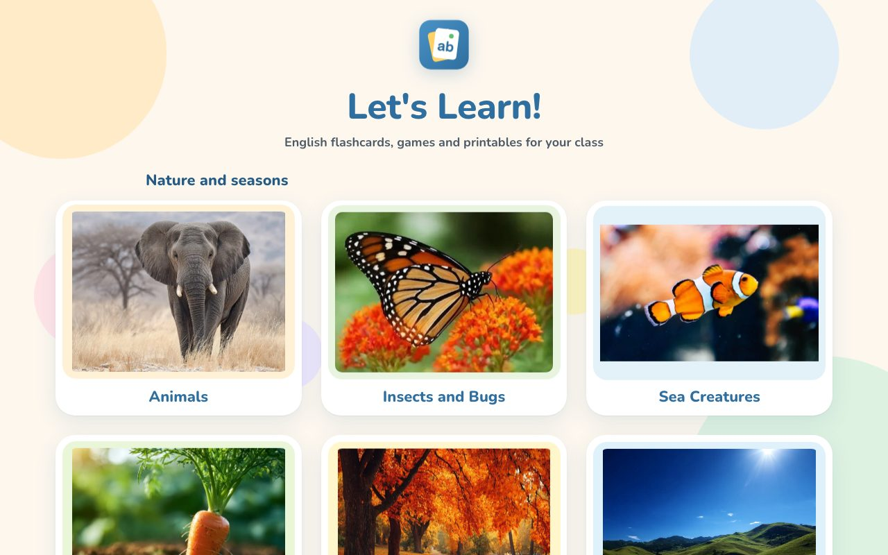
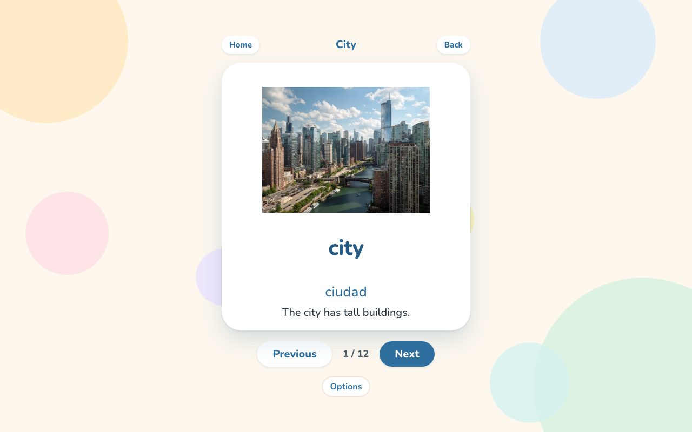
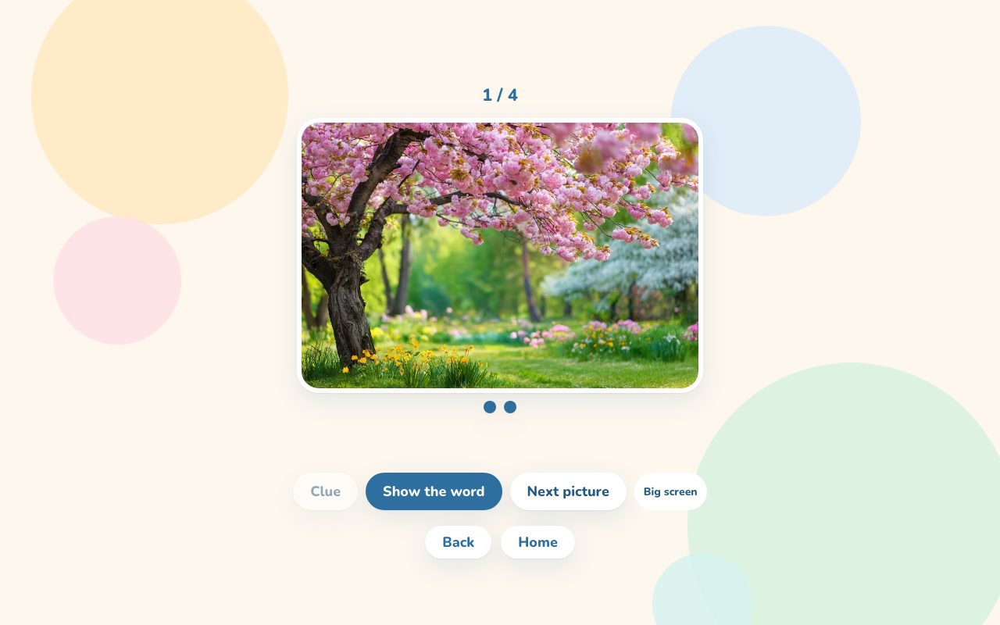
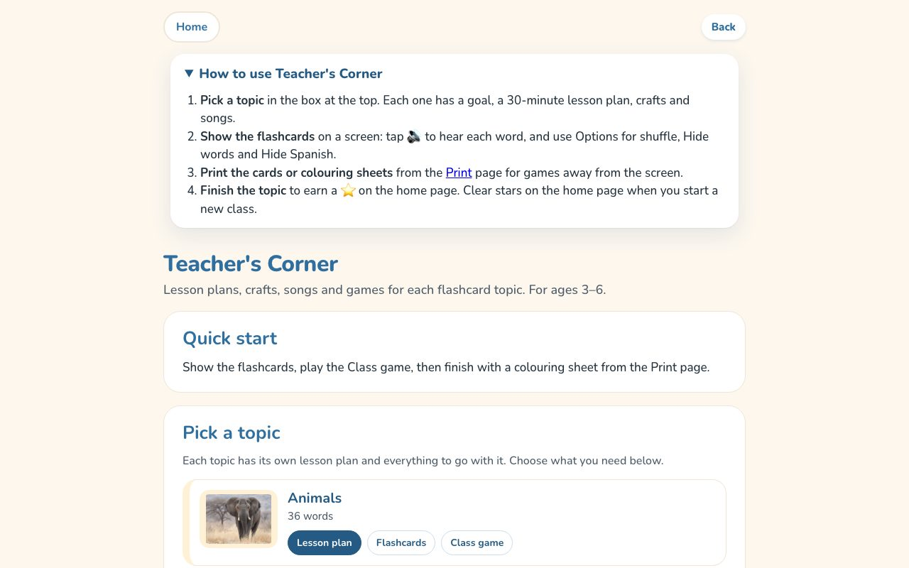
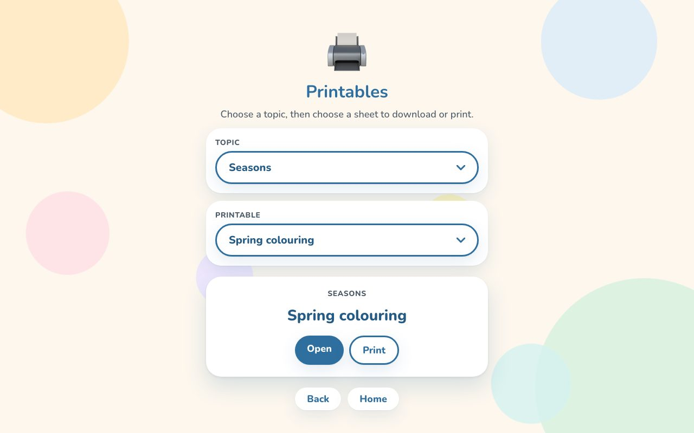
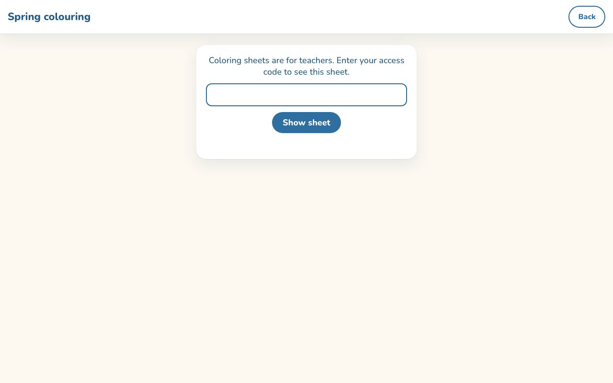
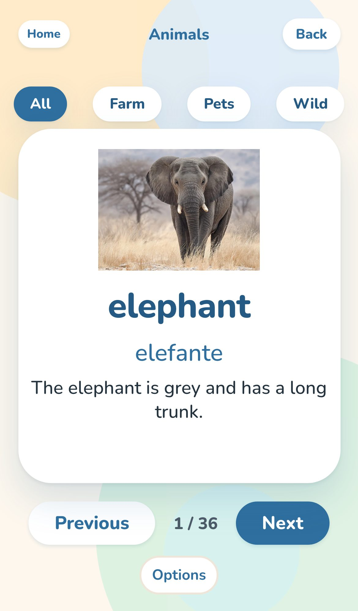

# Let's Learn! English flashcards for children aged 3 to 6

[](https://github.com/msell587/kids-flashcards/actions/workflows/ci.yml)
[](https://github.com/msell587/kids-flashcards/actions/workflows/pages.yml)

Bilingual (English and Spanish) flashcards, listening games, printable sheets and lesson plans for teachers of young children. It runs in any browser, and it can be installed on a phone, tablet or classroom computer and used offline.

**Live site:** [msell587.github.io/kids-flashcards](https://msell587.github.io/kids-flashcards/)

<p align="center">
  
  
</p>

## Why it exists

Teachers of 3 to 6 year olds need material they can put on a classroom screen in seconds: big pictures, one word at a time, a voice that says the word, and something to print for afterwards. Most free material is scattered across sites, full of ads or needs an account. This app keeps a whole lesson in one place, with no sign-up and nothing collected about the children.

## What it does

- **18 topics** (animals, seasons, weather, city, feelings, transport and more), each with flashcards that show a picture, the English word, the Spanish word and a short sentence
- **Spoken words** using the device's own text-to-speech voice, with a voice picker
- **About 20 games**, such as picture guess, sorting, memory, quizzes and a whole-class game, plus a **big screen** mode for a TV or projector
- **Teacher's Corner** with a 30-minute lesson plan, songs, crafts and games for every topic
- **Printables:** worksheets for everyone, and colouring sheets for teachers behind an access code
- **Classroom options** to shuffle, hide words, hide Spanish or hide sentences, remembered on the device
- **Works offline** after the first visit, and installs like an app

<p align="center">
  
  
</p>
<p align="center">
  
  
</p>
<p align="center">
  
</p>

## How it is built

| Part | Choice |
|---|---|
| Pages | Plain HTML, CSS and JavaScript, no framework, so it loads fast on old school computers |
| Content | One data file (`topics.js`) holds every topic, word, translation, sentence and picture. Pages and games read from it |
| Build | [Vite](https://vite.dev/) builds every page into `dist/` |
| Offline | A service worker (`sw.js`) saves pages on the first visit. It shows the saved copy at once and fetches updates in the background |
| Voice | The browser's Web Speech API, choosing the most natural English voice on the device |
| Hosting | GitHub Pages, published by GitHub Actions on every push to `main` |
| Tests | [Vitest](https://vitest.dev/) checks the content and the access code logic; [Playwright](https://playwright.dev/) runs browser smoke tests. Both run on every push |

### Colouring sheets behind a teacher code

The colouring sheets are only for teachers, but the site is static and this repository is public. So the PDFs are kept out of both:

```
Teacher's browser                    Google Apps Script               Private Google Drive folder
pdf-view.html  ── path + code ──▶   checks the code against   ──▶   reads the PDF by name
               ◀── PDF (base64) ──   TEACHER_CODES
```

- The PDFs live in a private Google Drive folder. They are not in git (`.gitignore`), not in the build (`vite.config.js` filters them out), and they were removed from the git history.
- `sheet-access.js` holds the rule for which files are gated. The build and the viewer page share it, so the two cannot disagree.
- The Apps Script (`apps-script/Code.gs`) checks the code and sends the file back as base64 JSON, because Apps Script web apps cannot return binary files. The teacher codes and the folder ID are script properties, never in the code.
- The request is sent as `text/plain` so the browser does not need a CORS preflight, which Apps Script cannot answer.
- The code is remembered only until the tab is closed, so a teacher types it once per visit, not once per sheet.

**Trade-off:** this is one shared code, not a login per teacher. It keeps the sheets away from casual visitors and search engines at no hosting cost. It is not meant to protect secret data.

## Privacy

The app does not collect information about children. It has no accounts or sign-up, no analytics and no ads. Options and progress stars are stored only on the device. Details are on the [privacy page](privacy.html).

## Running it locally

You need [Node.js](https://nodejs.org/) 20 or newer.

```bash
npm install
npm run dev        # development server
npm test           # unit tests (Vitest)
npm run test:e2e   # browser tests (Playwright)
npm run build      # build the site into dist/
npm run preview    # serve the built site
```

The colouring sheets need the Apps Script set up (see the comments at the top of `apps-script/Code.gs`). Everything else works without it.

## Project layout

| Path | What it holds |
|---|---|
| `*.html` | The home page, one page per topic, the games, the printables and the Teacher's Corner |
| `topics.js`, `teacher-content.js` | Content: topics, words, sentences and lesson plans |
| `flashcards.js`, `game-common.js`, `voice.js`, `bigscreen.js` | Shared behaviour for flashcards, games, speech and big screen mode |
| `sheet-access.js`, `pdf-view.html`, `apps-script/Code.gs` | The colouring sheet access code gate |
| `sw.js`, `pwa.js`, `manifest.webmanifest` | Offline support and install settings |
| `theme.css`, `style.css`, `game.css`, `teacher.css` | Styles |
| `images/`, `icons/`, `printables/` | Pictures and public printable files |
| `tests/` | Unit tests and browser smoke tests |
| `.github/workflows/` | Test-and-build and deploy workflows |

## Known limitations and next steps

- The topic pages are near copies of each other. The next step is one template page generated from `topics.js`.
- Several pages keep their script inside the HTML. These will move into modules.
- TypeScript, linting, image optimisation and an accessibility audit are still to do.
- Colouring sheets take a few seconds to open, because Apps Script starts up on demand.

## Image sources

All pictures were made with AI image tools (Midjourney or Canva), according to the author. None is a stock photo or a photo of a real child. Sources and licence checks are listed in [PHOTO-SOURCES.md](PHOTO-SOURCES.md); the licence checks are not complete yet.

## Licence

_To be decided by the author._
